# A SQL Based, Data Driven Analysis of the World's 200 Richest People
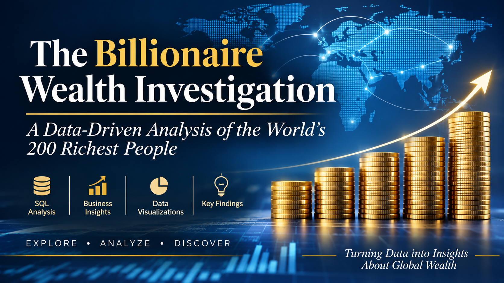
## Project Overview

This project analyzes a dataset of the world's 200 richest billionaires using SQL. The dataset has seven columns.

| Column | Type | Description |
|---|---|---|
| `serial_number` | Integer | Unique row identifier (1-200) |
| `rank` | Integer | Wealth rank (ties share a rank) |
| `name` | String | Billionaire or family name |
| `age` | Integer | Age in years |
| `country` | String | Country of citizenship/residence |
| `networth_billion` | Float | Net worth in US$ billions (`networth_billion_US_dollars` in the source CSV) |
| `industry` | String | Primary industry |

**Dataset totals (verified against the CSV):** 200 billionaires, combined net worth of **US$6,368.5 billion**, average age **69.38**, average net worth **US$31.84 billion**.

## Tools and Technologies

- **SQL:** Data querying, aggregation, filtering, sorting, and analysis.
- **SQLite:** Relational database management.
- **SQLite Online:** SQL query execution environment.
- **GitHub:** Project documentation, version control, and presentation.
- **Markdown:** Documentation and result presentation.

## Project Objectives

The main objectives of this project are to:

- Identify the world's wealthiest individuals and families.
- Examine billionaire wealth distribution across countries.
- Analyze the industries contributing to global billionaire wealth.
- Explore the relationship between age and net worth.
- Measure wealth concentration among the richest individuals.
- Identify patterns and trends through SQL-based analysis.
- Generate meaningful business insights to support data-driven decision-making.

## SQL Skills Demonstrated

This project demonstrates practical application of the following SQL concepts:

- SELECT and DISTINCT
- WHERE and ORDER BY
- GROUP BY and HAVING
- Aggregate Functions: COUNT(), SUM(), AVG(), MIN(), MAX()
- LIMIT
- Subqueries
- CASE WHEN statements
- Conditional Aggregation
- ROUND() function

## Project Methodology

The analysis followed these main stages:

1. **Data Understanding:** Reviewed the dataset structure, columns, and available records.
2. **Database Preparation:** Created the `billionaires` table and imported the dataset into SQLite.
3. **Exploratory Data Analysis:** Examined record counts, missing values, duplicate identifiers, countries, and industries.
4. **SQL Analysis:** Developed and executed 20 SQL queries to answer business questions and investigate additional patterns.
5. **Result Interpretation:** Evaluated query outputs and translated the findings into meaningful business insights.
6. **Documentation:** Organized SQL queries, screenshots, interpretations, and findings into this GitHub repository.


## Source and Verification Notes

- **Query source:** All 20 queries come from your uploaded SQL script and were checked against it programmatically (identical apart from comments and whitespace). Numbering follows the script: Q1-Q10 are the instructor's questions and Q11-Q20 are your additional analyses. (In some screenshots your additional analyses are labelled 1-10 because they were run from an earlier version of the script.)
- **Script setup:** The script creates the `billionaires` table and loads it from a staging table `temp_billionaires`. It also runs preliminary checks (record count, missing values, duplicate `serial_number`, distinct countries and industries). These are not among the 20 analyses and are not documented here. The script does not clean or trim text values.
- **Results:** Every result comes from the PDF screenshots. Each was cross-checked by recomputing it from the CSV, and all matched. Any figure not shown in a screenshot is labelled *derived from the CSV*.
- **Table and column names:** The queries use the table `billionaires` and the column `networth_billion`. The CSV header is `networth_billion_US_dollars`, so the column was renamed when the data was loaded.
- **Data-quality issue affecting several results:** Two country values in the CSV have stray whitespace: `'China '` (trailing space, Lu Xiangyang) and `' Brazil'` (leading space, Marcel Herrmann Telles). `GROUP BY country` treats them as separate countries. This is why China and Brazil each appear twice in the country-level results (Q5 and Q18). The effect is described in the relevant sections and again in the final section.

---

# Part 1: Business Questions

## Q1. Retrieve the 20 richest billionaires

**Objective:** List the 20 individuals or families with the highest net worth, to show who sits at the top of the wealth distribution.

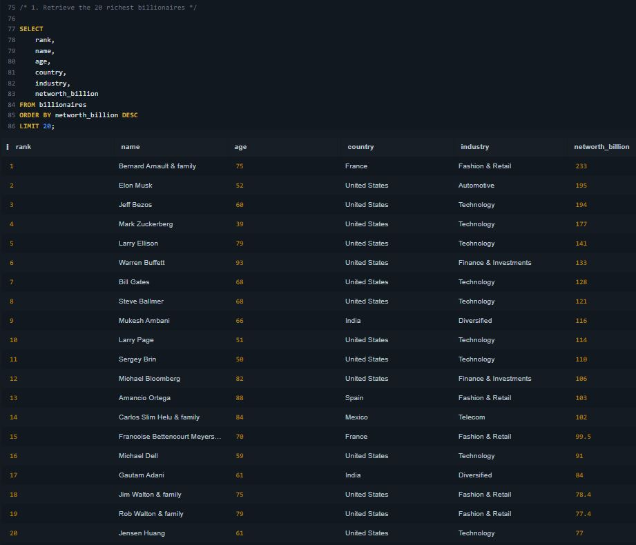

**SQL Query**
```sql
/* 1. Retrieve the 20 richest billionaires */

SELECT
    rank,
    name,
    age,
    country,
    industry,
    networth_billion
FROM billionaires
ORDER BY networth_billion DESC
LIMIT 20;
```

**SQL Explanation**

- `SELECT` picks the six descriptive columns.
- `ORDER BY networth_billion DESC` sorts from richest to poorest.
- `LIMIT 20` keeps only the first 20 rows.

**Result Interpretation**

| Rank | Name | Age | Country | Industry | Net Worth ($B) |
|---|---|---|---|---|---|
| 1 | Bernard Arnault & family | 75 | France | Fashion & Retail | 233 |
| 2 | Elon Musk | 52 | United States | Automotive | 195 |
| 3 | Jeff Bezos | 60 | United States | Technology | 194 |
| 4 | Mark Zuckerberg | 39 | United States | Technology | 177 |
| 5 | Larry Ellison | 79 | United States | Technology | 141 |
| 6 | Warren Buffett | 93 | United States | Finance & Investments | 133 |
| 7 | Bill Gates | 68 | United States | Technology | 128 |
| 8 | Steve Ballmer | 68 | United States | Technology | 121 |
| 9 | Mukesh Ambani | 66 | India | Diversified | 116 |
| 10 | Larry Page | 51 | United States | Technology | 114 |
| 11 | Sergey Brin | 50 | United States | Technology | 110 |
| 12 | Michael Bloomberg | 82 | United States | Finance & Investments | 106 |
| 13 | Amancio Ortega | 88 | Spain | Fashion & Retail | 103 |
| 14 | Carlos Slim Helu & family | 84 | Mexico | Telecom | 102 |
| 15 | Francoise Bettencourt Meyers & family | 70 | France | Fashion & Retail | 99.5 |
| 16 | Michael Dell | 59 | United States | Technology | 91 |
| 17 | Gautam Adani | 61 | India | Diversified | 84 |
| 18 | Jim Walton & family | 75 | United States | Fashion & Retail | 78.4 |
| 19 | Rob Walton & family | 79 | United States | Fashion & Retail | 77.4 |
| 20 | Jensen Huang | 61 | United States | Technology | 77 |

Bernard Arnault & family lead at US$233B, and Elon Musk (US$195B) and Jeff Bezos (US$194B) follow. Fourteen of the 20 entries are from the United States, and the rest are from France (2), India (2), Spain (1) and Mexico (1) (all counted from the screenshot).

**Business Insight:** Extreme wealth is concentrated in a few individuals and in Technology. Nine of the top 20 are in Technology, and Fashion & Retail contributes five (counts from the screenshot). The top of the list is dominated by the United States, with France and India each contributing two entries.

*Limitation:* Several entries are "& family" figures, so they represent family wealth rather than a single individual.

---

## Q2. Identify the five youngest billionaires

**Objective:** Find the youngest members of the list and see where their wealth comes from.
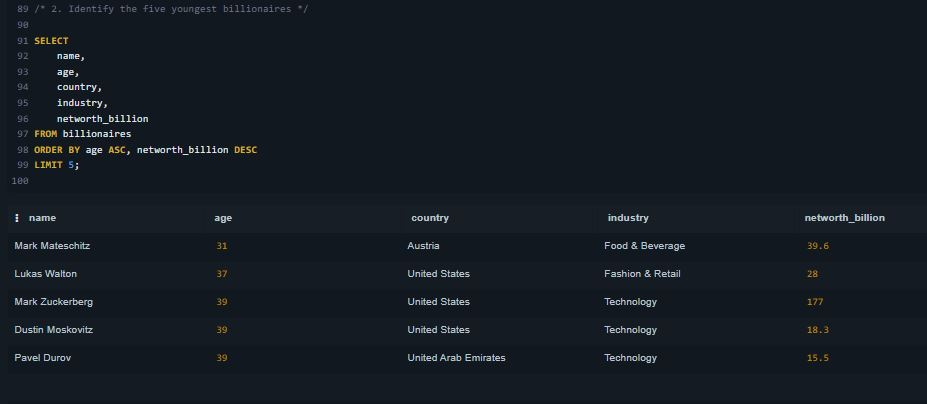


**SQL Query**

```sql
/* 2. Identify the five youngest billionaires */

SELECT
    name,
    age,
    country,
    industry,
    networth_billion
FROM billionaires
ORDER BY age ASC, networth_billion DESC
LIMIT 5;
```

**SQL Explanation**

- `ORDER BY age ASC` puts the youngest first.
- `networth_billion DESC` is a tie-breaker that places the richer person first when ages are equal.
- `LIMIT 5` returns five rows.

**Result Interpretation**
The youngest is Mark Mateschitz, aged 31, and the next is Lukas Walton, aged 37. Three people share age 39. Checking the CSV confirms that all three 39-year-olds fit within the limit of 5, so the tie-breaker did not exclude anyone.

**Business Insight:** Three of the five youngest are in Technology. The two youngest (Mateschitz and Walton) have wealth from Food & Beverage and Fashion & Retail. The dataset has no field for source of wealth (for example, founded versus inherited), so the origin of these fortunes cannot be determined from the data.

---

## Q3. Calculate average age and average net worth

**Objective:** Establish baseline benchmarks for the whole dataset.
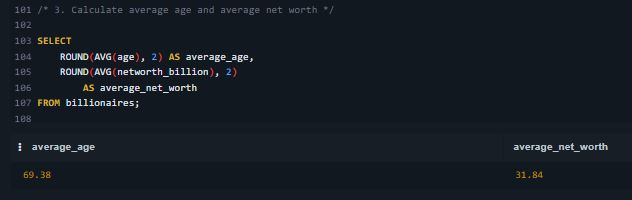


**SQL Query**

```sql
/* 3. Calculate average age and average net worth */

SELECT
    ROUND(AVG(age), 2) AS average_age,
    ROUND(AVG(networth_billion), 2)
        AS average_net_worth
FROM billionaires;
```

**SQL Explanation**

- `AVG()` calculates the mean of a column.
- `ROUND(..., 2)` limits the output to two decimals.
- No `GROUP BY` is used, so the query returns one row for the whole table.

**Result Interpretation**
The typical billionaire on this list is about 69 years old, with an average net worth of US$31.84B.

**Business Insight:** The average of US$31.84B is well above the minimum of US$10.7B (see Q16). The mean is pulled up by a small number of very large fortunes. These benchmarks are used again in Q9, which finds billionaires above the average.

*Limitation:* A mean is sensitive to outliers. A median would better represent the "typical" billionaire, but it was not part of this analysis.

---

## Q4. Identify the five most represented countries

**Objective:** Find the countries with the most billionaires on the list.
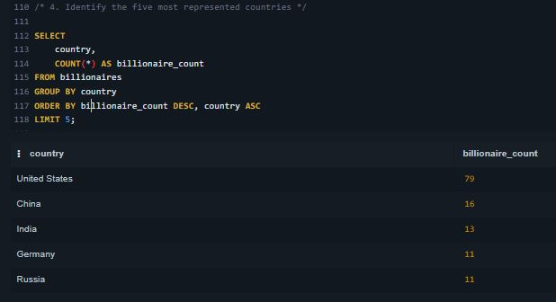

**SQL Query**

```sql
/* 4. Identify the five most represented countries */

SELECT
    country,
    COUNT(*) AS billionaire_count
FROM billionaires
GROUP BY country
ORDER BY billionaire_count DESC, country ASC
LIMIT 5;
```

**SQL Explanation**

- `GROUP BY country` makes one group per country.
- `COUNT(*)` counts the rows in each group.
- `ORDER BY billionaire_count DESC, country ASC` ranks by count and breaks ties alphabetically.
- `LIMIT 5` keeps the top five.

**Result Interpretation**
The United States has 79 of the 200 billionaires. That is 39.5% (*derived from the CSV*), and about five times as many as China, in second place. Germany and Russia tie at 11 and are ordered alphabetically.

**Business Insight:** The US dominates billionaire counts. The next four countries combined (51) hold fewer than the United States alone.

*Limitation:* China's count of 16 excludes one billionaire whose country value is stored as `'China '` (with a trailing space). The true count is 17, so the ranking is unaffected. If a tie had been close, this issue could have changed the result.

---

## Q5. Calculate combined net worth by country

**Objective:** Measure each country's total billionaire wealth alongside its billionaire count.
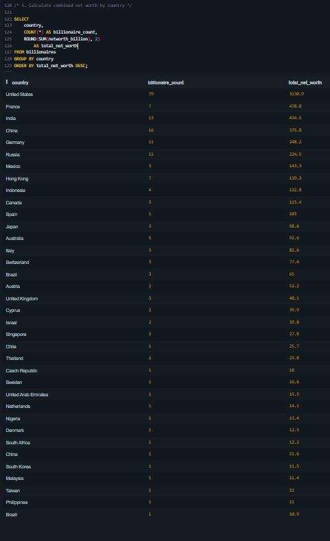


**SQL Query**

```sql
/* 5. Calculate combined net worth by country */

SELECT
    country,
    COUNT(*) AS billionaire_count,
    ROUND(SUM(networth_billion), 2)
        AS total_net_worth
FROM billionaires
GROUP BY country
ORDER BY total_net_worth DESC;
```

**SQL Explanation**

- `SUM(networth_billion)` totals the wealth within each country group.
- `COUNT(*)` adds the number of billionaires for context.
- `ORDER BY total_net_worth DESC` lists the wealthiest countries first.

**Result Interpretation**

The United States holds US$3,130.9B, which is 49.2% of the dataset total of US$6,368.5B (*derived from the CSV*). France ranks second despite having only 7 billionaires, because Arnault and Bettencourt Meyers are both in the top 15. China ranks fourth by wealth despite having the second-highest count. Spain has a single entry (US$103B) but still appears in the top 11 by total wealth.

**Business Insight:** Wealth concentration varies by country. France and Spain have very large individual fortunes, whereas China and India show a wider spread of smaller ones.

*Limitation:* The screenshot lists China and Brazil twice (China 375.8 and 11.6; Brazil 65 and 10.9) because of the whitespace issue described above. Combined, China would be US$387.4B (17 billionaires) and Brazil US$75.9B (4 billionaires), both *derived from the CSV*. The top 10 would be unchanged, and China would remain fourth.

---

## Q6. Identify the five industries with the highest number of billionaires

**Objective:** Find which industries produce the most billionaires and compare that with their total wealth.
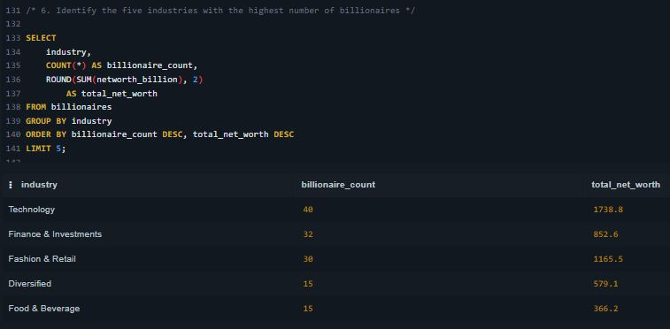


**SQL Query**

```sql
/* 6. Identify the five industries with the highest number of billionaires */

SELECT
    industry,
    COUNT(*) AS billionaire_count,
    ROUND(SUM(networth_billion), 2)
        AS total_net_worth
FROM billionaires
GROUP BY industry
ORDER BY billionaire_count DESC, total_net_worth DESC
LIMIT 5;
```

**SQL Explanation**

- Grouping by `industry` gives one row per sector.
- The count and the sum are calculated together.
- The second sort key, `total_net_worth DESC`, breaks ties in count.

**Result Interpretation**

Technology leads on both count (40) and wealth. Diversified and Food & Beverage tie at 15 billionaires, and the tie-breaker orders Diversified first because its total wealth is higher. Fashion & Retail ranks third by count but second by total wealth, so its billionaires are on average richer than those in Finance & Investments.

**Business Insight:** Technology accounts for 27.3% of all billionaire wealth (1,738.8 / 6,368.5, *derived from the CSV*). Technology, Finance & Investments, and Fashion & Retail together hold 102 of the 200 billionaires.

---

## Q7. Find countries with at least five billionaires

**Objective:** Filter the country list to markets with a meaningful presence of billionaires.
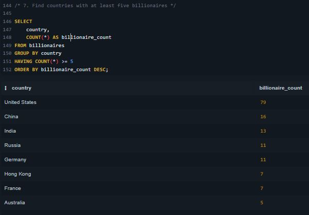


**SQL Query**

```sql
/* 7. Find countries with at least five billionaires */

SELECT
    country,
    COUNT(*) AS billionaire_count
FROM billionaires
GROUP BY country
HAVING COUNT(*) >= 5
ORDER BY billionaire_count DESC;
```

**SQL Explanation**

- `HAVING` filters *after* aggregation, which is how a condition on `COUNT(*)` is applied. `WHERE` cannot do this because it runs before grouping.
- `ORDER BY billionaire_count DESC` sorts the qualifying countries by size.

**Result Interpretation**

Eight countries meet the threshold. Together they have 149 billionaires (79 + 16 + 13 + 11 + 11 + 7 + 7 + 5, a sum of the screenshot values), which is about 75% of the list.

**Business Insight:** All other countries share the remaining 51 billionaires. Billionaire wealth is geographically concentrated, with Hong Kong, France and Australia as the smaller members of the group.

*Limitation:* Because of the `'China '` whitespace, China's true count is 17, though it still clears the threshold. No other country is affected near the cutoff of 5. Brazil has 4 with its stray-space entry included, and would stay below 5.

---

## Q8. Calculate the total wealth of billionaires younger than 50

**Objective:** Quantify how much wealth is held by younger billionaires.
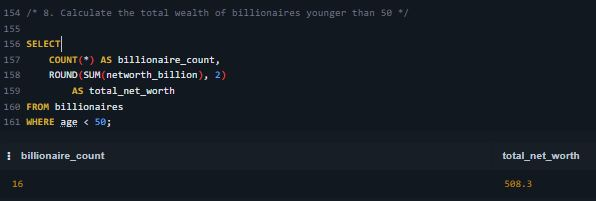


**SQL Query**

```sql
/* 8. Calculate the total wealth of billionaires younger than 50 */

SELECT
    COUNT(*) AS billionaire_count,
    ROUND(SUM(networth_billion), 2)
        AS total_net_worth
FROM billionaires
WHERE age < 50;
```

**SQL Explanation**

- `WHERE age < 50` filters rows before aggregation.
- `COUNT(*)` and `SUM()` then summarize only the filtered rows.

**Result Interpretation**
Sixteen billionaires are under 50, and together they hold US$508.3B. That is 8% of the billionaires but 7.98% of the total wealth (*derived from the CSV*), so the younger group is represented about in proportion to its size, with an average of about US$31.8B each (508.3 / 16, *derived*).

**Business Insight:** Younger billionaires hold wealth roughly in line with their numbers, unlike the dataset's ageing majority. A large part of this group's wealth comes from a few Technology founders (Zuckerberg alone is US$177B, see Q17).

---

## Q9. Identify billionaires whose net worth exceeds the overall average

**Objective:** List everyone above the dataset's mean net worth of US$31.84B.
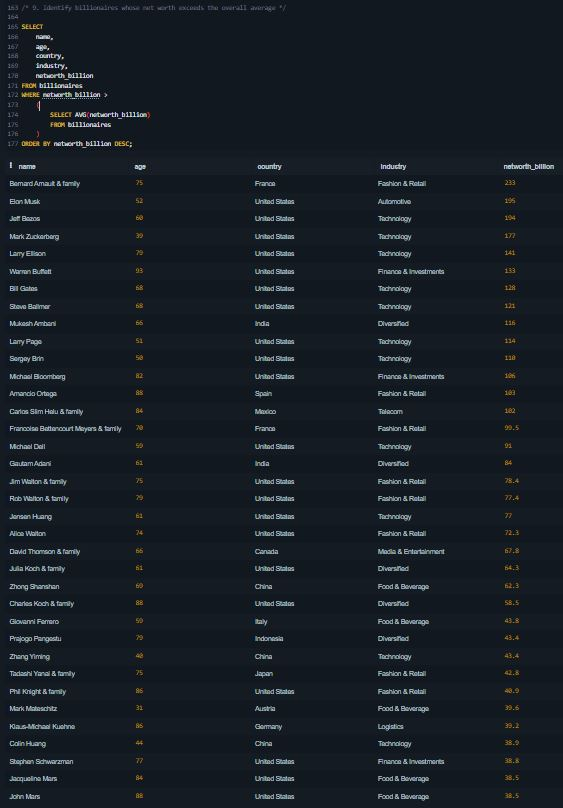


**SQL Query**

```sql
/* 9. Identify billionaires whose net worth exceeds the overall average */

SELECT
    name,
    age,
    country,
    industry,
    networth_billion
FROM billionaires
WHERE networth_billion >
    (
        SELECT AVG(networth_billion)
        FROM billionaires
    )
ORDER BY networth_billion DESC;
```

**SQL Explanation**

- The **subquery** `SELECT AVG(networth_billion) FROM billionaires` computes the average once (about 31.84).
- The outer `WHERE` keeps only rows above that value.
- Using a subquery avoids hard-coding the average, so the query stays correct if the data changes.

**Result Interpretation**

The screenshot shows the results from Bernard Arnault & family (US$233B) down to John Mars (US$38.5B). It continues beyond the visible area. Counting rows in the CSV with net worth above 31.84 gives **53 billionaires**, or 26.5% of the list (*derived from the CSV*). The visible portion repeats the Q1 top 20, followed by names such as Giovanni Ferrero (43.8), Zhang Yiming (43.4), Mark Mateschitz (39.6) and Stephen Schwarzman (38.8).

**Business Insight:** Only about a quarter of billionaires exceed the mean, which confirms that the distribution is right-skewed. A small group of very large fortunes lifts the average above what most billionaires hold.

*Limitation:* The screenshot truncates the result set, so the 53 count comes from the CSV rather than from the screenshot.

---

## Q10. Identify the industry with the highest average net worth

**Objective:** Find which industry has the wealthiest billionaires on average.
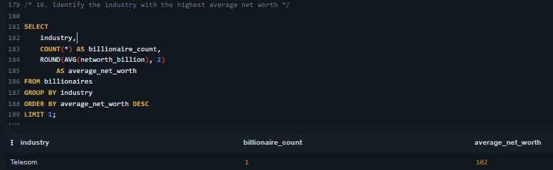


**SQL Query**

```sql
/* 10. Identify the industry with the highest average net worth */

SELECT
    industry,
    COUNT(*) AS billionaire_count,
    ROUND(AVG(networth_billion), 2)
        AS average_net_worth
FROM billionaires
GROUP BY industry
ORDER BY average_net_worth DESC
LIMIT 1;
```

**SQL Explanation**

- `GROUP BY industry` with `AVG()` gives each sector's mean.
- `ORDER BY ... DESC LIMIT 1` returns the single highest.
- Including `COUNT(*)` makes the group size visible.

**Result Interpretation**

Telecom has the highest average because its only billionaire is Carlos Slim Helu & family (US$102B). The screenshot is low-resolution, and the value is not perfectly legible, so it was confirmed from the CSV, which gives 102.0.

**Business Insight:** The result is accurate but not very informative. An average based on one person simply equals that person's net worth. The more meaningful comparison is among industries with several billionaires. From the CSV, Technology averages US$43.47B across 40 billionaires and Fashion & Retail US$38.85B across 30 (*derived from the CSV*).

*Limitation:* Adding `HAVING COUNT(*) >= 5` would remove the single-member effect.

---

# Part 2: Additional Data Analysis

## Q1. Identify the 10 oldest billionaires

**Objective:** See who the oldest members of the list are and how their wealth compares.
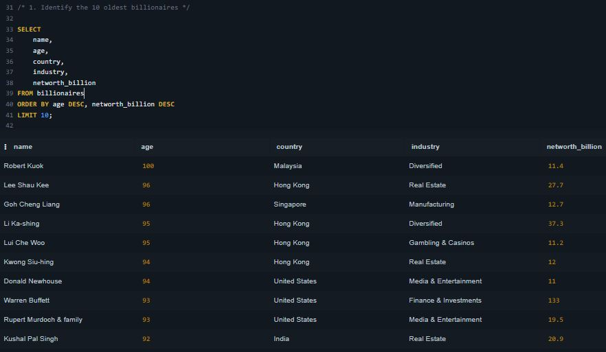

**SQL Query**

```sql
/* 1. Identify the 10 oldest billionaires */

SELECT
    name,
    age,
    country,
    industry,
    networth_billion
FROM billionaires
ORDER BY age DESC, networth_billion DESC
LIMIT 10;
```

**SQL Explanation**

- `ORDER BY age DESC` ranks the oldest first.
- `networth_billion DESC` breaks ties (for example, between those aged 96, 95, 94, 93).
- `LIMIT 10` returns ten rows.

**Result Interpretation**
Robert Kuok is the oldest at 100. Hong Kong accounts for four of the ten. Warren Buffett is the only one with a very large fortune (US$133B).

**Business Insight:** Most of the oldest billionaires are in Real Estate, Diversified or Media, and are typically at modest net worth levels compared with the top 20. The dataset cannot show how these fortunes are held or passed on.

*Limitation:* Age is a snapshot, and the dataset does not show whether the wealth is already held by heirs or trusts.

---

## Q2. Country with the highest average billionaire net worth

**Objective:** Compare countries by average (not total) billionaire wealth.
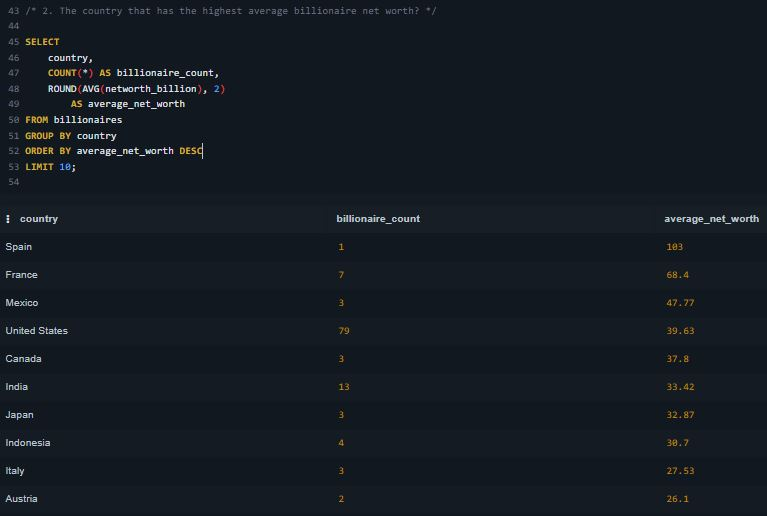


**SQL Query**

```sql
/* 2. The country that has the highest average billionaire net worth? */

SELECT
    country,
    COUNT(*) AS billionaire_count,
    ROUND(AVG(networth_billion), 2)
        AS average_net_worth
FROM billionaires
GROUP BY country
ORDER BY average_net_worth DESC
LIMIT 10;
```

**SQL Explanation**

- `AVG()` per country group, with `COUNT(*)` to show group size.
- `LIMIT 10` keeps the top ten countries.

**Result Interpretation**

Spain ranks first only because its single billionaire is Amancio Ortega (US$103B). France (US$68.4B across 7 people) is the highest country with a sizeable group. The United States has the largest group and still averages US$39.63B.

**Business Insight:** Average wealth is heavily influenced by one or two mega-fortunes in countries with small samples (Spain, Mexico, Canada). France and the United States are the more reliable benchmarks.

*Limitation:* Countries with 1-3 billionaires give unstable averages. A minimum group size would improve the comparison.

---

## Q3. Percentage of total wealth held by the top 10 billionaires

**Objective:** Measure how concentrated total wealth is at the very top.
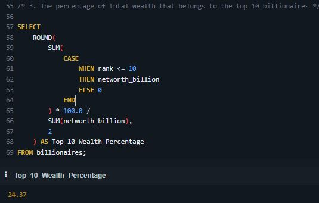

**SQL Query**

```sql
/* 3. The percentage of total wealth that belongs to the top 10 billionaires? */

SELECT
    ROUND(
        SUM(
            CASE
                WHEN rank <= 10
                THEN networth_billion
                ELSE 0
            END
        ) * 100.0 /
        SUM(networth_billion),
        2
    ) AS Top_10_Wealth_Percentage
FROM billionaires;
```

**SQL Explanation**

- `CASE WHEN rank <= 10 THEN networth_billion ELSE 0 END` keeps only top-10 wealth inside the sum (conditional aggregation).
- The outer `SUM(...)` is divided by the total `SUM(networth_billion)`.
- `* 100.0` forces decimal division, which avoids integer truncation, and `ROUND(..., 2)` gives two decimals.

**Result Interpretation**

The top 10 billionaires (5% of the list) hold **24.37%** of the combined wealth.

**Business Insight:** Five percent of the list holds almost a quarter of its wealth. See Q20 for the top-20 comparison, which holds 38.95%.

*Limitation:* The query relies on the `rank` column, which contains ties in lower ranks. For the top 10, ranks are unique, so exactly 10 people are counted.

---

## Q4. Industry contributing the greatest combined wealth

**Objective:** Identify the industry whose billionaires hold the most total wealth.
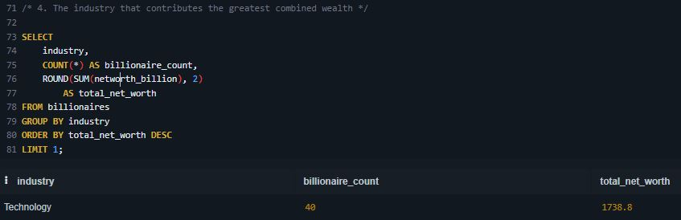


**SQL Query**

```sql
/* 4. The industry that contributes the greatest combined wealth */

SELECT
    industry,
    COUNT(*) AS billionaire_count,
    ROUND(SUM(networth_billion), 2)
        AS total_net_worth
FROM billionaires
GROUP BY industry
ORDER BY total_net_worth DESC
LIMIT 1;
```

**SQL Explanation**

- Same `GROUP BY industry` logic as Q6, but sorted by total wealth and limited to a single row.

**Result Interpretation**

**Business Insight:** Technology is first by wealth as well as by count (Q6), and it holds 27.3% of the dataset total (*derived from the CSV*). It is ahead of Fashion & Retail (US$1,165.5B, from Q6) by US$573.3B.

*Note:* This is closely related to Q6, which already reported the same total, so it is partly a confirmation.

---

## Q5. Number of billionaires under 40

**Objective:** Measure how rare billionaires under 40 are.
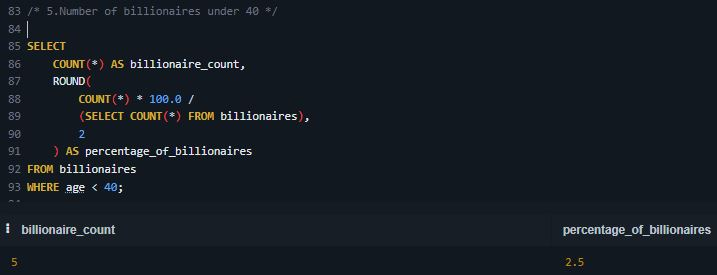

**SQL Query**

```sql
/* 5. Number of billionaires under 40 */

SELECT
    COUNT(*) AS billionaire_count,
    ROUND(
        COUNT(*) * 100.0 /
        (SELECT COUNT(*) FROM billionaires),
        2
    ) AS percentage_of_billionaires
FROM billionaires
WHERE age < 40;
```

**SQL Explanation**

- `WHERE age < 40` filters to under-40s before counting.
- The scalar subquery `(SELECT COUNT(*) FROM billionaires)` returns the total row count (200), which cannot be obtained from the filtered rows.
- `100.0` forces decimal division.

**Result Interpretation**
Five of the 200 billionaires (2.5%) are under 40. These match the five youngest in Q2.

**Business Insight:** Billionaires under 40 are very rare in this dataset.

---

## Q6. Wealth difference between the richest and least wealthy billionaires

**Objective:** Measure the spread of the distribution from top to bottom.
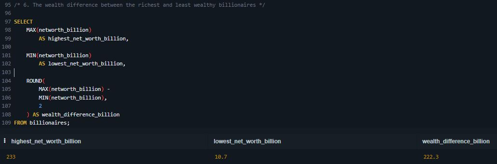


**SQL Query**

```sql
/* 6. The wealth difference between the richest and least wealthy billionaires */

SELECT
    MAX(networth_billion)
        AS highest_net_worth_billion,

    MIN(networth_billion)
        AS lowest_net_worth_billion,

    ROUND(
        MAX(networth_billion) -
        MIN(networth_billion),
        2
    ) AS wealth_difference_billion
FROM billionaires;
```

**SQL Explanation**

- `MAX()` and `MIN()` return the extremes.
- Subtracting them gives the range, and `ROUND(..., 2)` tidies the decimals.

**Result Interpretation**

The richest person (Bernard Arnault & family, US$233B) is worth US$222.3B more than the 200th (Suleiman Kerimov & family, US$10.7B; name from the CSV), about 21.8 times as much (*derived*).

**Business Insight:** A 21.8x gap within a list of only 200 people shows how steeply wealth falls off, even among billionaires.

*Limitation:* The range uses only two data points and says nothing about the distribution between them.

---

## Q7. Age group with the highest combined wealth

**Objective:** Compare wealth across age bands.
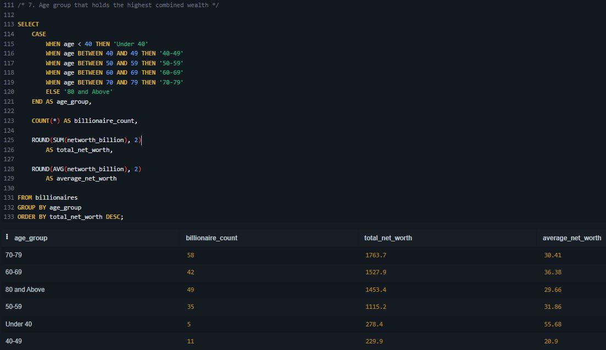


**SQL Query**

```sql
/* 7. Age group that holds the highest combined wealth */

SELECT
    CASE
        WHEN age < 40 THEN 'Under 40'
        WHEN age BETWEEN 40 AND 49 THEN '40-49'
        WHEN age BETWEEN 50 AND 59 THEN '50-59'
        WHEN age BETWEEN 60 AND 69 THEN '60-69'
        WHEN age BETWEEN 70 AND 79 THEN '70-79'
        ELSE '80 and Above'
    END AS age_group,

    COUNT(*) AS billionaire_count,

    ROUND(SUM(networth_billion), 2)
        AS total_net_worth,

    ROUND(AVG(networth_billion), 2)
        AS average_net_worth

FROM billionaires
GROUP BY age_group
ORDER BY total_net_worth DESC;
```

**SQL Explanation**

- `CASE WHEN` creates age bands, evaluated in order, so each person falls into the first matching band.
- `GROUP BY age_group` groups by the derived label, and the count, sum and average are computed per band.
- `ORDER BY total_net_worth DESC` ranks bands by combined wealth.

**Result Interpretation**
The 70-79 group holds the most wealth, mainly because it has the most people (58). Under 40 has the highest average (US$55.68B) from just 5 people. The 40-49 group has the lowest average (US$20.90B).

**Business Insight:** The 60-69 group has the highest average among large groups. Combined, those aged 60 and over hold 4,745 of the 6,368.5 total, about 74.5% (*derived from the screenshot values*).

*Limitation:* The Under-40 average is driven by Mark Zuckerberg, whose US$177B is 63.6% of that group's US$278.4B (*derived from the CSV*). Without him the average of the other four is US$25.35B. The age bands are also not equal in width.

---

## Q8. Average net worth by country

**Objective:** Compute average billionaire net worth for every country.
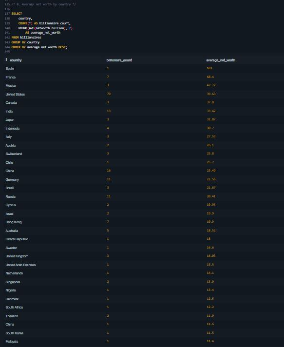

**SQL Query**

```sql
/* 18. Average net worth by country */

SELECT
    country,
    COUNT(*) AS billionaire_count,
    ROUND(AVG(networth_billion), 2)
        AS average_net_worth
FROM billionaires
GROUP BY country
ORDER BY average_net_worth DESC;
```

**SQL Explanation**

- The same logic as Q12, without `LIMIT`, so every country appears.

**Result Interpretation** (selected rows from the screenshot)

The top of the table matches Q12. Among the larger groups, China averages US$23.49B and Germany US$22.56B. China appears twice in the screenshot (16 billionaires at 23.49 and a separate single row at 11.6). Brazil also appears twice (3 billionaires at 21.67 and a separate row at 10.9, outside the rows shown here). The screenshot is cut off after Malaysia, so some bottom rows are not visible.

**Business Insight:** Average wealth falls steeply after the US, and only a few countries average above US$30B. Countries with many billionaires (China, Germany, Russia) average lower than the US.

*Limitation:* The duplicate China and Brazil rows result from the whitespace issue. With the values merged, China would have 17 billionaires averaging about US$22.79B, and Brazil 4 averaging about US$18.98B (*derived from the CSV*). The query overlaps with Q12, which shows only the top 10.

---

## Q9. Industries with the highest and lowest average ages

**Objective:** Find out which industries have the oldest and youngest billionaires.
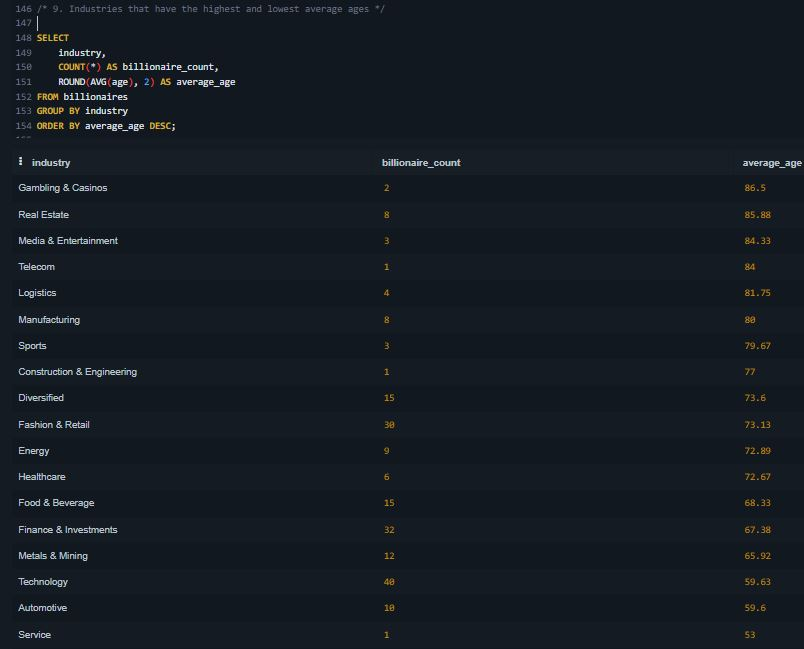

**SQL Query**

```sql
/* 9. Industries that have the highest and lowest average ages */

SELECT
    industry,
    COUNT(*) AS billionaire_count,
    ROUND(AVG(age), 2) AS average_age
FROM billionaires
GROUP BY industry
ORDER BY average_age DESC;
```

**SQL Explanation**

- `AVG(age)` per industry, sorted from oldest to youngest, so the highest is at the top and the lowest at the bottom.

**Result Interpretation**

The oldest industry is Gambling & Casinos (86.5), though with only 2 people. Real Estate (8 billionaires) is the oldest industry with a larger group. The youngest is Service (53, one person), followed by Automotive (59.6) and Technology (59.63).

**Business Insight:** Technology, the largest sector, has an average age about 10 years below the dataset average of 69.38 (from Q3). Capital-heavy and legacy sectors (Real Estate, Manufacturing, Media) skew old.

*Limitation:* Industries with 1-3 members (Gambling, Media, Telecom, Service, Construction) are weak evidence.

---

## Q10. Top 20 versus the remaining 180 billionaires

**Objective:** Compare the combined wealth of the top 20 with the other 180.
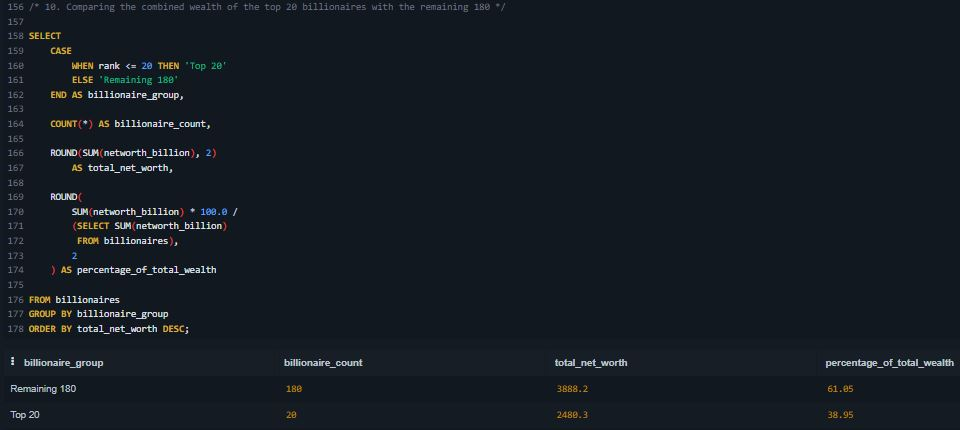

**SQL Query**

```sql
/* 10. Comparing the combined wealth of the top 20 billionaires with the remaining 180 */

SELECT
    CASE
        WHEN rank <= 20 THEN 'Top 20'
        ELSE 'Remaining 180'
    END AS billionaire_group,

    COUNT(*) AS billionaire_count,

    ROUND(SUM(networth_billion), 2)
        AS total_net_worth,

    ROUND(
        SUM(networth_billion) * 100.0 /
        (SELECT SUM(networth_billion)
         FROM billionaires),
        2
    ) AS percentage_of_total_wealth

FROM billionaires
GROUP BY billionaire_group
ORDER BY total_net_worth DESC;
```

**SQL Explanation**

- `CASE` splits rows into two labelled groups.
- `GROUP BY billionaire_group` aggregates each group.
- The scalar subquery returns the dataset total, which is used as the denominator for each group's share.

**Result Interpretation**

The top 20 (10% of the list) hold **38.95%** of the combined wealth. The two groups add up to US$6,368.5B, which matches the CSV total.

**Business Insight:** Together with Q13, this shows wealth concentration at several cut-offs: the top 10 hold 24.37% and the top 20 hold 38.95%. So the 11th to 20th billionaires add 14.58 percentage points (*derived*).

---

# Key Findings

The investigation revealed several important patterns in the wealth distribution of the world's 200 richest people:

- **Total Wealth:** The dataset contains approximately US$6,368.5 billion in combined net worth.
- **Geographical Concentration:** The United States accounts for 79 billionaires, representing 39.5% of the dataset.
- **Industry Dominance:** Technology leads with 40 billionaires and approximately US$1,738.8 billion in combined wealth.
- **Wealth Concentration:** The top 10 billionaires hold 24.37% of the total wealth.
- **Top 20 Wealth:** The 20 richest billionaires control 38.95% of the combined wealth.
- **Age Distribution:** The average age is 69.38 years, while only five billionaires are under 40.
- **Wealth Gap:** The difference between the richest and least wealthy individuals on the list is US$222.3 billion.

## Limitations and Data Quality Considerations

- **Dataset Scope:** The analysis covers only 200 billionaires and does not represent the entire global population of wealthy individuals.
- **Data Snapshot:** Age and net worth represent the dataset's recorded values and may change over time.
- **Country Formatting:** Leading and trailing spaces in some country names cause duplicate country groups in certain SQL results.
- **Average-Based Comparisons:** Averages can be influenced by exceptionally large fortunes and countries with very few billionaires.
- **Source of Wealth:** The dataset does not identify whether wealth was inherited, self-made, or acquired through other means.
- **Industry Classification:** Each billionaire is associated with a primary industry, which may not capture all their business interests.

# Conclusion

This project demonstrates how SQL can be used to investigate global wealth distribution and transform raw data into meaningful insights.

Through 20 SQL queries, the analysis explored billionaire demographics, geographical distribution, industry representation, and wealth concentration.

The findings highlight the significant role of the United States and the Technology industry in the dataset, while also revealing how a relatively small number of billionaires control a substantial share of the combined wealth.

Overall, the project strengthened practical SQL skills in data exploration, aggregation, filtering, subqueries, and analytical problem-solving.
